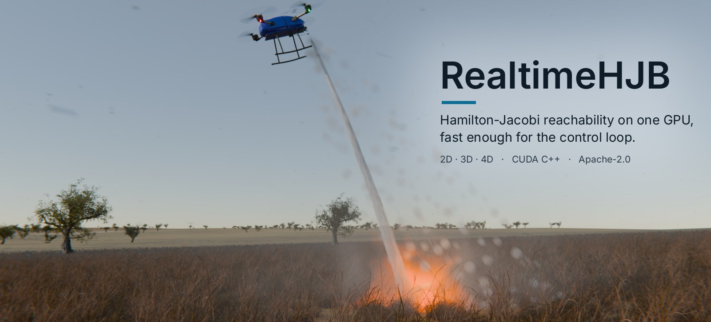
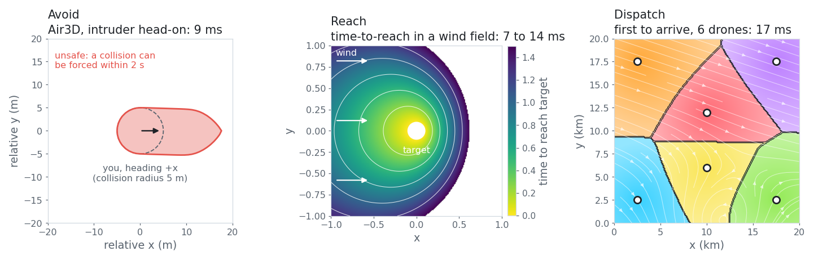

<p align="center">
  
</p>

# RealtimeHJB

[](https://github.com/MirrorAI-corp/realtime-hjb/actions/workflows/ci.yml)
[](https://github.com/MirrorAI-corp/realtime-hjb/actions/workflows/codeql.yml)
[](https://scorecard.dev/viewer/?uri=github.com/MirrorAI-corp/realtime-hjb)
[](https://github.com/MirrorAI-corp/realtime-hjb/releases/latest)
[](LICENSE)
[](https://arxiv.org/abs/2611.04096)

RealtimeHJB is a CUDA library for Hamilton-Jacobi reachability on a grid. It
computes backward reachable tubes and minimum time-to-reach maps for 2D, 3D
and 4D systems in milliseconds on one GPU, fast enough to recompute them inside
a robot's control loop.

## What it solves

### In practice

A robot often needs to know, right now, what can happen over the next few
seconds or minutes, given how it moves and what the wind, the terrain or
another agent might do. RealtimeHJB answers that kind of question:

- **Collision avoidance.** From which relative positions and headings can
  another aircraft, drone or vehicle force a collision within T seconds,
  whatever you do? Staying outside that set keeps you safe for the whole
  horizon, and its boundary tells a safety filter when to override the
  nominal controller.
- **Reaching a goal despite disturbances.** How fast can a vehicle reach a
  target from every starting state when wind or current pushes it around, and
  from where is arrival guaranteed at all?
- **Dispatch.** With several vehicles, which one gets to each point first? In
  a strong wind it is often not the nearest one: a drone upwind can beat a
  closer drone that has to fly into a headwind.
- **Pursuit and interception.** Where can a pursuer catch an evader in the
  plane, with walls and position-dependent speed limits.

One solve takes milliseconds, so these answers can be recomputed every control
cycle as the wind, the obstacles or the other agents change, instead of being
computed offline for one fixed scenario.

### Mathematically

For a system $\dot x = f(x, u, d)$ with a bounded control $u$, a bounded
disturbance $d$ and a target set $\mathcal T = \lbrace x : V_0(x) \le 0 \rbrace$,
RealtimeHJB solves the Hamilton-Jacobi-Isaacs equation on a grid, in
time-to-go $t \in [0, T]$:

```math
\frac{\partial V}{\partial t} = \min\bigl\{0,\ H(x, \nabla V)\bigr\},
\qquad
H(x, p) = \min_{u} \max_{d}\ p \cdot f(x, u, d),
\qquad
V(x, 0) = V_0(x).
```

For avoid problems the control and the disturbance swap roles. From the
solution it returns:

- the **backward reachable tube** $\lbrace x : V(x, T) \le 0 \rbrace$: every state from
  which the target can be reached within $T$ against the worst-case
  disturbance (for avoid problems, from which the disturbance can force entry
  into the unsafe set);
- the **minimum time-to-reach** $T^\ast(x) = \min\lbrace t \le T : V(x, t) \le 0 \rbrace$
  of every cell;
- for $K$ agents, the **capture-basin partition**
  $\ell(x) = \arg\min_k T_k^\ast(x)$, the agent that reaches each cell first,
  from a single solve rather than $K$;
- **reach-avoid** values, when obstacles are given as constraints.

<picture>
  <source media="(prefers-color-scheme: dark)" srcset="docs/images/problems-dark.png">
  
</picture>

<sub>Output of three of the examples, drawn by
[docs/images/make_readme_figure.py](docs/images/make_readme_figure.py). Left:
relative positions from which a head-on intruder can force a collision within
2 s. Middle: time to reach a target with the wind blowing to the right; starting
upwind is faster. Right: six drones in a 20 km gusty wind field, each colour the
area that drone reaches first. Times are on an RTX 4000 Ada in FP32.</sub>

## How it works

It uses the standard level-set scheme of Mitchell's ToolboxLS and the JAX
library [hj_reachability](https://github.com/StanfordASL/hj_reachability):
fifth-order WENO in space, third-order TVD Runge-Kutta in time and
Lax-Friedrichs dissipation. Results agree with hj_reachability to within the
discretization error (see [docs/performance.md](docs/performance.md)). The
solver design and its evaluation are described in
[arXiv:2611.04096](https://arxiv.org/abs/2611.04096).

| Problem | Grid | Time on an RTX 4000 Ada (FP32) |
|---|---|---|
| Air3D collision avoidance (3D) | 51 x 51 x 51 | 8.9 ms |
| Air3D collision avoidance (3D) | 101 x 101 x 101 | 102 ms |
| Vehicle in a wind field, time-to-reach (2D) | 200 x 200 | 6.8 to 13.6 ms |
| Pursuit-evasion (4D) | 31^4 | 16.4 ms |

These are 6 to 18 times faster than hj_reachability on the same GPU.

## Solvers

| Function | System | State |
|---|---|---|
| `solveGPU_HolonomicL2` | point robot, speed bound | 2D |
| `solveGPU_DoubleIntegrator2D` | position and velocity, acceleration bound | 2D |
| `solveGPU_Drifter` | vehicle in a spatially varying flow field, with a bounded disturbance | 2D |
| `solveGPU_Air3D` | two-aircraft collision avoidance game | 3D |
| `solveGPU_PursuitEvasion4D` | two agents in the plane, optional walls and speed maps | 4D |

Each takes a grid, an initial value function whose zero sublevel set is the
target, and options (horizon, scheme order, FP32 or FP64). It returns the value
function at the horizon and, optionally, the time-to-reach of every cell. The
drifter solver can also split the reachable region between several agents (a
capture-basin Voronoi partition) in one solve.

## Quick start

Requirements: Linux, an NVIDIA GPU, CUDA 12 or 13, CMake 3.18 or later and a
C++17 compiler.

```bash
git clone https://github.com/MirrorAI-corp/realtime-hjb.git
cd realtime-hjb
cmake -S . -B build -DCMAKE_CUDA_ARCHITECTURES=89-real   # your GPU, see below
cmake --build build -j
ctest --test-dir build --output-on-failure
./build/examples/air3d_brt
```

Set `CMAKE_CUDA_ARCHITECTURES` to your GPU's compute capability without the dot
(`nvidia-smi --query-gpu=compute_cap --format=csv,noheader` prints it): `89-real`
for RTX 40 series and RTX Ada, `86-real` for RTX 30, `90-real` for H100,
`110-real` for Jetson AGX Thor. With CMake 3.24 or later, `native` also works.

```cpp
#include <hjb/hjb.hpp>

int main() {
    using hjb::BoundaryType;
    hjb::Grid grid = hjb::Grid::create(
        3, {-20, -20, 0}, {20, 20, 2 * M_PI}, {51, 51, 51},
        {BoundaryType::Extrapolate, BoundaryType::Extrapolate, BoundaryType::Periodic});

    // Collision set: within 5 m in (x, y), for every relative heading.
    hjb::ArrayND v0 = hjb::shapeCylinder(grid, {false, false, true}, {0, 0, 0}, 5.0);

    hjb::SolveOptions opts;
    opts.accuracy = hjb::AccuracyLevel::VeryHigh;  // WENO5 + TVD-RK3
    opts.precision = hjb::Precision::FP32;
    opts.tMax = 2.0;                                // horizon, seconds

    hjb::SolveResult r = hjb::gpu::solveGPU_Air3D(grid, v0, opts, 5.0, 5.0, 1.0);
    // r.final_data <= 0 marks every state from which a collision can be forced
    // within 2 s.
}
```

## Prebuilt libraries and container image

Each [release](https://github.com/MirrorAI-corp/realtime-hjb/releases) has the
static library, headers and CMake config for Linux x86_64 (CUDA 12 and 13) and
aarch64 (CUDA 13, including Jetson AGX Thor). Unpack one and point
`CMAKE_PREFIX_PATH` at it; `BUILD_INFO.txt` lists the GPU architectures it
contains. Every archive carries a build provenance attestation:

```bash
gh attestation verify realtime-hjb-0.1.2-linux-x86_64-cuda13.tar.gz --repo MirrorAI-corp/realtime-hjb
```

The container image has the library, the examples and the tests on the CUDA
13.2 runtime, for x86_64 and arm64:

```bash
docker run --rm --gpus all ghcr.io/mirrorai-corp/realtime-hjb            # runs the tests
docker run --rm --gpus all --user "$(id -u):$(id -g)" -v "$PWD":/work \
    ghcr.io/mirrorai-corp/realtime-hjb air3d_brt                         # writes ./air3d_V.npy
```

The examples write into the working directory, `/work`. Mount a directory
there and pass `--user` so the files belong to you rather than root.

## Documentation

- [Getting started](docs/getting-started.md): build, run the examples, write your first solve.
- [Concepts](docs/concepts.md): value functions, reachable tubes, time-to-reach and sign conventions.
- [Solvers](docs/solvers.md): dynamics, Hamiltonian, parameters and options for each solver.
- [Using RealtimeHJB in your project](docs/using-in-your-project.md): CMake `find_package`, `add_subdirectory` and `FetchContent`.
- [Performance](docs/performance.md): timings, FP32 versus FP64, comparison with hj_reachability.

## Repository layout

| Path | Contents |
|---|---|
| `include/hjb/`, `src/` | the library |
| `examples/` | small programs that each solve one problem, plus a closed-loop wildfire-fleet simulation |
| `tests/` | regression and analytic tests (`ctest`) |
| `fuzz/` | libFuzzer targets for the host-side code, run by ClusterFuzzLite |

## Citing

If you use RealtimeHJB in your research, please cite the paper:

K. Weekly and A. M. Bayen, "Online Hamilton-Jacobi Reachability Onboard the
Robot Control Loop: A Real-Time GPU Solver for Safety-Critical Autonomy,"
arXiv:2611.04096, 2026. <https://arxiv.org/abs/2611.04096>

```bibtex
@misc{weekly2026realtimehjb,
  title         = {Online Hamilton-Jacobi Reachability Onboard the Robot Control Loop:
                   A Real-Time GPU Solver for Safety-Critical Autonomy},
  author        = {Kevin Weekly and Alexandre M. Bayen},
  year          = {2026},
  eprint        = {2611.04096},
  archivePrefix = {arXiv},
  primaryClass  = {cs.RO},
  url           = {https://arxiv.org/abs/2611.04096}
}
```

[CITATION.cff](CITATION.cff) has the same information, and GitHub's "Cite this
repository" button uses it.

## Contributing and security

Issues are welcome; see [CONTRIBUTING.md](CONTRIBUTING.md) for how changes are
made. Report security problems privately as described in
[SECURITY.md](SECURITY.md).

## License

Copyright 2026 Mirror AI, Corp. Licensed under the Apache License, Version 2.0;
see [LICENSE](LICENSE) and [NOTICE](NOTICE).
